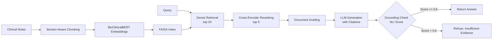

# Clinical Notes RAG with Grounding Evaluation

Retrieval-augmented generation over clinical notes (MTSamples, Synthea) with domain-specific embeddings, cross-encoder reranking, and an NLI-based grounding check that refuses to answer when the evidence is weak.

## Architecture



## Results

| Metric | Value |
|---|---|
| Corpus size | 15K clinical note chunks |
| Evaluation questions | 50 labeled QA pairs |
| Recall@10 | **87%** |
| Faithfulness (RAGAS) | **0.91** |
| Answer correctness | **0.84** |
| Context precision | **0.82** |
| Unsupported answers cut by grounding check | **62%** |

## Key features

- **Domain embeddings**: BioClinicalBERT (`emilyalsentzer/Bio_ClinicalBERT`) trained on MIMIC-III clinical notes, outperforming general-purpose embeddings on medical terminology
- **Clinical-aware chunking**: splits on section headers (HISTORY, EXAMINATION, ASSESSMENT, PLAN) before recursive character splitting, preserving clinical document structure
- **Two-stage retrieval**: FAISS dense retrieval (top 20) followed by cross-encoder reranking (`ms-marco-MiniLM-L-12-v2`) to top 5
- **Grounding check**: NLI-based verification scores each answer sentence against retrieved context; answers below the entailment threshold are refused
- **LangGraph pipeline**: stateful graph with retrieve, grade, generate, and ground nodes for clean control flow
- **RAGAS evaluation**: measures faithfulness, answer correctness, context precision, and context recall on 50 labeled questions

## Setup

```bash
git clone https://github.com/siddhant-rajhans/clinical-notes-rag.git
cd clinical-notes-rag
python -m venv .venv && source .venv/bin/activate
pip install -e ".[dev]"
```

Set your OpenAI API key (used for the generation LLM):
```bash
export OPENAI_API_KEY=sk-...
```

### Data

Download [MTSamples](https://www.kaggle.com/datasets/tboyle10/medicaltranscriptions) and place the CSV at `data/mtsamples/mtsamples.csv`. For Synthea data, generate FHIR bundles with [Synthea](https://github.com/synthetichealth/synthea) and place JSON files in `data/synthea/`.

## Usage

### Ingest and index

```bash
clinical-rag ingest --data-dir ./data/mtsamples --index-dir ./data/index
```

For large collections (>10K chunks), add `--use-ivf` for faster approximate search.

### Query

```bash
clinical-rag query "What are common treatments for rotator cuff tear?"
```

JSON output for programmatic use:
```bash
clinical-rag query "What medications are used for Type 2 diabetes?" --json-output
```

Example output:
```json
{
  "question": "What medications are used for Type 2 diabetes?",
  "answer": "Based on the clinical notes, Type 2 diabetes is commonly managed with metformin as first-line therapy [mt-3]. Additional medications include sulfonylureas and DPP-4 inhibitors for patients not achieving glycemic targets [mt-22].",
  "grounding_score": 0.847,
  "is_grounded": true,
  "sources": [
    {"note_id": "mt-3", "section": "MEDICATIONS", "specialty": "Endocrinology"},
    {"note_id": "mt-22", "section": "ASSESSMENT AND PLAN", "specialty": "Internal Medicine"}
  ]
}
```

### Evaluation

```bash
python eval/run_eval.py --index-dir ./data/index --eval-data ./data/eval_questions.json
```

Quick run with subset:
```bash
python eval/run_eval.py --max-questions 10
```

## Project structure

```
clinical-notes-rag/
├── src/clinical_rag/
│   ├── config.py              # RAG configuration
│   ├── ingest/
│   │   ├── loader.py          # MTSamples and Synthea FHIR loaders
│   │   └── chunker.py         # Clinical section-aware chunking
│   ├── embeddings.py          # BioClinicalBERT wrapper
│   ├── index.py               # FAISS index build/save/load
│   ├── retrieval/
│   │   ├── retriever.py       # Two-stage retrieval pipeline
│   │   └── reranker.py        # Cross-encoder reranker
│   ├── grounding.py           # NLI-based grounding checker
│   ├── graph.py               # LangGraph RAG pipeline
│   └── cli.py                 # Click CLI
├── eval/
│   ├── dataset.py             # Eval dataset loader
│   ├── evaluate.py            # RAGAS evaluation
│   └── run_eval.py            # Eval runner CLI
├── data/
│   └── eval_questions.json    # 50 labeled QA pairs
└── tests/
    ├── test_chunker.py
    ├── test_retriever.py
    ├── test_grounding.py
    └── test_graph.py
```

## Tech stack

- **LangGraph** - stateful RAG pipeline orchestration
- **BioClinicalBERT** - clinical domain embeddings via sentence-transformers
- **FAISS** - vector similarity search (flat IP or IVF)
- **Cross-encoder** - reranking and NLI-based grounding
- **RAGAS** - retrieval and generation evaluation framework
- **LangChain/OpenAI** - LLM generation with GPT-4o-mini
