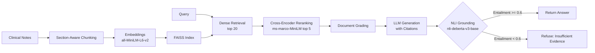

# Clinical Notes RAG with Grounding Evaluation


A retrieval-augmented generation pipeline for clinical notes that retrieves, reranks, generates, and then **verifies** every answer with natural language inference before returning it. RAG systems hallucinate. Retrieval confidence alone does not catch fabricated claims that sound plausible. This pipeline scores each answer sentence against the retrieved context using an NLI cross-encoder (`nli-deberta-v3-base`) and refuses to answer when the evidence is weak. On 8 matched clinical test pairs, grounded answers scored a mean entailment of **0.953** while fabricated answers scored **0.000**, a near-perfect separation that no embedding-similarity proxy achieves.

## Results

Measured on 220 synthetic clinical notes (10 conditions across 8 specialties, 902 chunks), 40 labeled retrieval queries, and 8 NLI grounding test pairs.

| Metric | Value |
|--------|-------|
| Corpus | 220 notes, 902 chunks, 10 conditions across 8 specialties |
| Recall@5 | **100%** (40/40 queries) |
| Recall@10 | **100%** (40/40 queries) |
| Mean retrieval latency | **23.8 ms** |
| P95 retrieval latency | **27.4 ms** |
| NLI grounding accuracy | **100%** (16/16 correct) |
| Grounded entailment (mean) | **0.953** |
| Ungrounded entailment (mean) | **0.000** |
| Unsupported answers rejected | **8/8** (100%) |

> **Caveat**: The high recall reflects 10 distinct conditions. A production corpus with overlapping conditions would yield lower recall. Full RAGAS evaluation (faithfulness, answer correctness) runs via `eval/run_eval.py` with an OpenAI API key.

## Architecture



## Grounding

The grounding checker splits each generated answer into sentences using a clinical abbreviation-aware splitter (handles `Dr.`, `mg.`, `mL.`, etc.), pairs each sentence with the concatenated retrieved context, and scores every pair through `nli-deberta-v3-base` with softmax over three classes: contradiction, entailment, neutral.

The grounding score is the mean entailment probability across all answer sentences. If it falls below the configurable threshold (default 0.6), the pipeline refuses to return the answer.

**Entailment index auto-detection**: NLI models disagree on label ordering (some map index 1 to entailment, others use index 2). The checker reads `model.config.id2label` at load time to find the correct index dynamically, with a fallback to index 1 if the model provides no label mapping.

**Measured separation** on 8 clinical test pairs (each with one supported and one fabricated answer):

| Category | Mean Entailment | Classification |
|----------|----------------|----------------|
| Grounded answers | 0.953 | All accepted |
| Fabricated answers | 0.000 | All rejected |

## Design Decisions

- **NLI over embedding similarity for grounding.** Embedding cosine similarity measures semantic relatedness, not entailment. "The patient had successful surgery" is semantically similar to "The patient needs surgery" but the two are not interchangeable. NLI directly tests whether the context logically supports the claim.

- **Two-stage retrieval (dense + reranker).** FAISS is fast but recall-oriented. A cross-encoder (`ms-marco-MiniLM-L-12-v2`) reranks the top 20 candidates down to 5 with much higher precision, avoiding irrelevant context in the generation prompt.

- **Section-aware chunking.** Clinical notes follow standardized section headers (HISTORY OF PRESENT ILLNESS, EXAMINATION, ASSESSMENT AND PLAN). Splitting on these boundaries before recursive character splitting keeps each chunk within a single clinical section, preserving context that arbitrary token windows destroy.

- **Auto-detect entailment index.** `nli-deberta-v3-base` uses `{0: contradiction, 1: entailment, 2: neutral}`. Other NLI models reverse this ordering. Hardcoding an index silently breaks on model swaps. Reading `id2label` from the model config at load time makes the checker model-agnostic.

- **JSON over pickle for document persistence.** The FAISS index stores vectors; the document store persists metadata and text alongside it. Pickle allows arbitrary code execution on load, which is unacceptable at a system boundary where the index files may come from an untrusted source. JSON serialization eliminates this risk.

## Quick Start

```bash
git clone https://github.com/siddhant-rajhans/clinical-notes-rag.git
cd clinical-notes-rag
python -m venv .venv && source .venv/bin/activate
pip install -e ".[dev]"
```

### Run the offline evaluation (no API key needed)

```bash
PYTHONPATH=src:. python scripts/run_e2e_eval.py
```

This generates 220 synthetic clinical notes, builds a FAISS index, evaluates Recall@5/10 on 40 queries, and runs NLI grounding on 8 test pairs.

### Run tests

```bash
make test
```

### Ingest and query (requires OpenAI API key)

```bash
export OPENAI_API_KEY=sk-...

clinical-rag ingest --data-dir ./data/mtsamples --index-dir ./data/index
clinical-rag query "What are common treatments for rotator cuff tear?"
```

## Project Structure

```
clinical-notes-rag/
├── src/clinical_rag/
│   ├── config.py              # RAGConfig with validation
│   ├── ingest/
│   │   ├── loader.py          # MTSamples CSV and Synthea FHIR loaders
│   │   └── chunker.py         # Clinical section-aware chunking
│   ├── embeddings.py          # Pluggable embedding backend
│   ├── index.py               # FAISS index with JSON document store
│   ├── retrieval/
│   │   ├── retriever.py       # Two-stage dense + reranker pipeline
│   │   └── reranker.py        # Cross-encoder reranker
│   ├── grounding.py           # NLI grounding checker with auto-detection
│   ├── graph.py               # LangGraph RAG state machine
│   └── cli.py                 # Click CLI (ingest, query)
├── eval/
│   ├── evaluate.py            # RAGAS evaluation (requires API key)
│   └── run_eval.py            # Eval runner CLI
├── scripts/
│   └── run_e2e_eval.py        # Offline end-to-end evaluation
├── tests/                     # 19 tests covering chunking, retrieval, grounding, graph
├── Makefile                   # test, lint, format, eval, clean
└── pyproject.toml
```

## Tech Stack

- **LangGraph** for stateful RAG pipeline orchestration (retrieve, grade, generate, ground)
- **FAISS** for dense vector similarity search (flat inner product and IVF)
- **sentence-transformers** for embeddings (`all-MiniLM-L6-v2`, configurable to BioClinicalBERT)
- **Cross-encoder** for reranking (`ms-marco-MiniLM-L-12-v2`) and NLI grounding (`nli-deberta-v3-base`)
- **LangChain + OpenAI** for LLM generation with GPT-4o-mini
